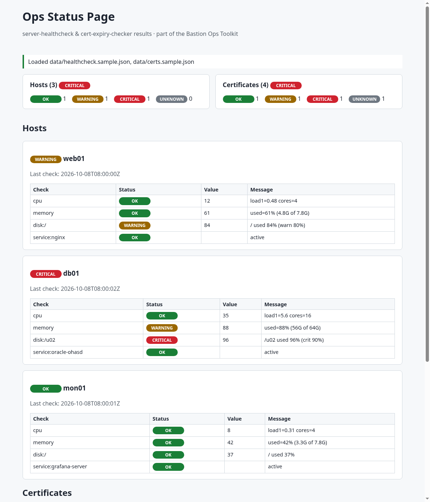

# ops-status-page

[](https://github.com/int3erlud3/ops-status-page/actions/workflows/ci.yml)
[](package.json)
[](LICENSE)

```text
                      _        _
   ___ _ __ ______ __| |_ __ _| |_ _  _ ______ _ __  __ _ __ _ ___
  / _ \ '_ (_-<___(_-<  _/ _` |  _| || (_-<___| '_ \/ _` / _` / -_)
  \___/ .__/__/   /__/\__\__,_|\__|\_,_/__/   | .__/\__,_\__, \___|
      |_|                                     |_|        |___/

+====================================================================+
|  OPS STATUS PAGE  ::  Health & Certificate Dashboard               |
+--------------------------------------------------------------------+
|  Static, CSP-locked view of healthcheck and cert-expiry JSON       |
|  v1.0.0  -  Bastion Ops Toolkit  -  by int3erlud3                  |
+====================================================================+
```

A small, dependency-free **static status dashboard** for the JSON produced by
[server-healthcheck](https://github.com/int3erlud3/server-healthcheck) and
[cert-expiry-checker](https://github.com/int3erlud3/cert-expiry-checker): summary cards,
per-host check tables and certificates sorted by urgency. Plain HTML, CSS and ES modules –
no framework, no build step, no external resources, and a **strict Content-Security-Policy**.



## Features

- Reads `data/healthcheck.json` and `data/certs.json` (falls back to the bundled
  `*.sample.json`), or JSON files chosen in the browser (read locally, never uploaded)
- Accepts a single server-healthcheck report, a list of reports, or `{"hosts": [...]}`
- Certificates sorted by status and days left; hosts with their checks, values and messages
- Light/dark theme via `prefers-color-scheme`
- Small CLI: `validate` JSON files (CI/monitoring exit codes) and `serve` the page locally

## Security design

- **Safe DOM rendering**: everything is built with `createElement`/`textContent`; no
  `innerHTML`, `insertAdjacentHTML`, `document.write` or `eval`. Enforced by ESLint
  (`eslint-plugin-no-unsanitized` + restricted properties) and by tests that render
  `` / `<script>` payloads and assert that no element is created.
- **Input validation**: unknown fields are dropped, strings are length-limited, statuses
  are mapped to a whitelist (CSS classes are never derived from input), list sizes and file
  sizes are capped.
- **CSP** (`<meta>` and HTTP header): `default-src 'none'; script-src 'self'; style-src 'self';
  connect-src 'self'` – no inline script/style, no third-party origins.
- **Local server**: binds to `127.0.0.1` by default, GET/HEAD only, blocks path traversal,
  dotfiles and symlinks leaving the web root, and sends `nosniff`, `X-Frame-Options: DENY`,
  `Referrer-Policy: no-referrer` and `Cache-Control: no-store`.

## Usage

```bash
git clone https://github.com/int3erlud3/ops-status-page.git
cd ops-status-page

# produce live data (on the monitored hosts / a monitoring box)
server-healthcheck --format json > public/data/healthcheck.json
cert-expiry-checker -i domains.txt -f json > public/data/certs.json

node bin/ops-status-page.js serve            # http://127.0.0.1:8080/
node bin/ops-status-page.js validate public/data/*.json
node bin/ops-status-page.js validate --json public/data/certs.json | jq .status
```

Multiple hosts: collect one report per host into a JSON array, e.g.
`jq -s . web01.json db01.json > public/data/healthcheck.json`.

Live `public/data/*.json` files are git-ignored; only the samples are committed.

The `public/` directory can be published by any static web server (nginx, Apache, an
internal GitHub Pages site, ...). If you serve it with your own web server, send the CSP
as an HTTP header as well (see [`src/server.js`](src/server.js) for the header set).

### CLI exit codes (`validate`)

| Code | Meaning |
|---|---|
| 0 | all items OK |
| 1 | at least one WARNING |
| 2 | at least one CRITICAL |
| 3 | UNKNOWN items, invalid JSON/schema or usage error |

The CLI banner is printed to **stderr** only on interactive terminals and never with
`--json`; disable it with `--no-banner` or `NO_BANNER=1`.

## Development

```bash
npm ci
npm run lint      # ESLint 10 + eslint-plugin-no-unsanitized
npm test          # node:test + linkedom (DOM), server and CLI tests
npm audit
```

## License

[MIT](LICENSE)
